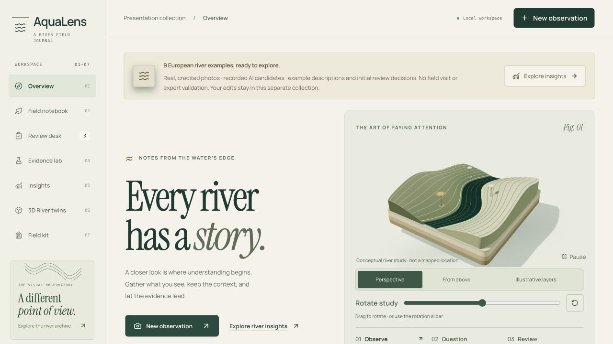
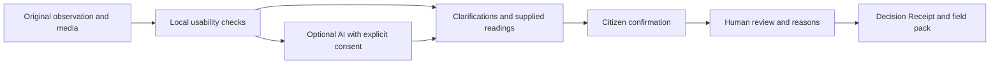
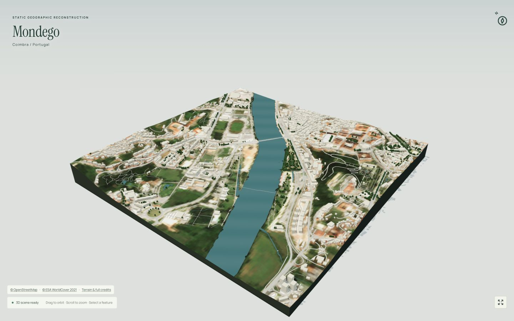
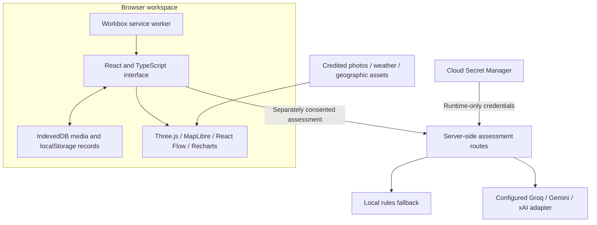

<div align="center">

# AquaLens

### Every river has a story. Keep the evidence behind it.

A river field journal that connects citizen observations, optional AI assistance, human review and geographic context in one traceable workspace.

[](https://github.com/Siddhanthkjain2005/IEEE/actions/workflows/ci.yml)


**[Open the live demo](https://aqualens-ruvn5g3vna-el.a.run.app/showcase)** · **[Explore the 3D rivers](https://aqualens-ruvn5g3vna-el.a.run.app/twins?collection=showcase)** · **[Browse the visual archive](https://aqualens-ruvn5g3vna-el.a.run.app/visuals?collection=showcase)**



</div>

A photograph can start a conversation about a river. It cannot, on its own, establish water safety or ecological health. AquaLens helps people preserve what they actually observed, ask useful follow-up questions, inspect uncertainty and document the human decisions that follow.

The result is a **Decision Receipt**: an inspectable record of the original evidence, checks, optional AI suggestions, clarifications, confirmation and review. The interface pairs a warm paper-and-forest visual language with photographic inspection, maps, evidence graphs and interactive 3D geography.

Built as an independent OneAquaHealth hackathon prototype. No organizer endorsement, competition result or scientific validation is claimed.

## Start exploring

| Entry point | What opens |
| --- | --- |
| **[Live showcase](https://aqualens-ruvn5g3vna-el.a.run.app/showcase)** | A separate collection with nine clearly labelled demonstration records. Real credited photographs and retained AI responses are distinguished from authored example notes and review decisions. |
| **[Your field workspace](https://aqualens-ruvn5g3vna-el.a.run.app/)** | A personal collection stored in your browser. Capture or upload evidence and follow the citizen-to-reviewer workflow. |
| **[Visual observatory](https://aqualens-ruvn5g3vna-el.a.run.app/visuals?collection=showcase)** | A photo chronicle, comparisons, source coverage, geographic context and an evidence constellation. |
| **[3D river explorer](https://aqualens-ruvn5g3vna-el.a.run.app/twins?collection=showcase)** | Geographic reconstructions of the Mondego, Garonne and Hoffselva, with layer controls, feature inspection and downloadable source receipts. |

For a walkthrough, open the showcase, inspect a source in **Overview**, follow a record into **Review desk**, then open **Evidence lab** and its receipt. Finish with **3D River twins** and the visual archive. A fresh AI assessment requires a separate consent action; replaying a recorded response does not call a provider.

## Seven sections, one evidence trail

| Section | What you can do |
| --- | --- |
| **Overview** | Explore the river study, inspect credited photos, add visual note pins, compare frames, inspect the evidence graph and open geographic context. |
| **Field notebook** | Capture or upload media, write your own observation, inspect local usability checks, supply readings you actually have, answer follow-up questions and explicitly confirm the record. |
| **Review desk** | Inspect original evidence and AI candidates, record agreement, disagreement or uncertainty with a reason, and retain the review history. |
| **Evidence lab** | Read decisions and their limits, inspect contradictions and completeness, replay retained events and export a Decision Receipt. |
| **Insights** | Explore collection coverage, source chronology, status filters, comparisons, charts and the evidence matrix. |
| **3D River twins** | Rotate, zoom and inspect three mapped river reaches; switch cameras, lighting and layers; inspect original feature tags and source provenance. |
| **Field kit** | Read evidence guidance and credits; export JSON, CSV, GeoJSON and portable field packs; preview imports and resolve conflicts explicitly. |

### From observation to Decision Receipt



Original words and media remain available throughout. AI suggestions require an explicit human acceptance step; unknown fields stay unknown. File digests support integrity checks, while review history explains decisions. Neither a digest nor a human approval establishes scientific truth.

## Geography you can inspect



The **3D River twins** section combines OpenStreetMap geometry, decoded terrain elevations and an annual ESA WorldCover Sentinel RGB composite. It retains **22,078 mapped features**, including **9,797 building footprints** and **5,953 mapped tree points** across three bounded reaches.

| River | Location | Display extent |
| --- | --- | --- |
| Mondego | Coimbra, Portugal | 1,700 m |
| Garonne | Toulouse, France | 1,700 m |
| Hoffselva | Western Oslo, Norway | 1,400 m |

Each scene offers aerial, river-focus and overhead cameras; pointer and keyboard navigation; lighting and layer switches; optional orbit; fullscreen; mapped-feature selection; and a downloadable source receipt containing URLs, dates, tags and digests. The renderer suspends when hidden or offscreen and provides a fallback when rendering is unavailable.

These are **static geographic reconstructions**. Terrain is rendered at 1:1 vertical scale; the surface imagery is an annual **2021** composite. Missing building heights, facades, tree shapes, some widths, bridge elevations and animated water are visibly disclosed approximations. There is no live water-level feed, bathymetry, hydraulic calibration or surveyed facade model. [Implementation and verification](docs/RIVER_TWINS_2026-10-04.md) · [Dataset attribution and ODbL extracts](public/river-twins/CREDITS.md).

## Real sources, distinct clocks

The active archive contains **39 licensed historical photographs**: 18 from Coimbra, 17 from Toulouse and four from Oslo, with source dates spanning **2005–2026**. Photographer credits, license links, original source metadata and retained-file digests accompany the images.

**78 retained Open-Meteo ERA5 windows** provide seven- and fifteen-day weather context around all 39 source dates. Regional modeled temperature, precipitation and wind remain separate from the photograph and from any citizen readings. The archive exposes source URLs, units, retrieval times and a UTC table.

The globe separates a dated **NASA Blue Marble August 2004 reference** from selectable daily satellite imagery, whose coverage gaps remain visible. City markers are geographic context, not camera GPS or sampling stations. Eight genuine retained Gemini responses are labelled recorded AI output; the nine showcase notes and initial review decisions are labelled authored examples.

## Architecture



| Layer | Implementation |
| --- | --- |
| Application | React 19, TypeScript, Next-compatible routes through Vinext and Vite |
| Interface | Radix primitives, Tailwind/CSS, Lucide, self-hosted Manrope and Instrument Serif |
| Exploration | Three.js, MapLibre GL JS, React Flow and Recharts |
| Validation and persistence | Zod, IndexedDB via `idb`, localStorage and versioned records |
| Optional AI | Server-side Groq, Gemini and xAI adapters; structured response validation and bounded failure handling |
| Hosting | Google Cloud Run, a multi-stage Node 22 container and Secret Manager; the original Cloudflare build target is retained |
| Offline assets | Workbox precaching for application and retained source assets; uncached maps, live weather and AI require a connection |

The public deployment uses **Groq for consented text and photo assistance**. Browser storage remains local to each origin; there is no shared cloud observation database or authenticated reviewer identity in this release.

## Run locally

Use **Node.js 22.13 or newer** and npm. Node 22 is used by the Cloud Run container and CI.

```bash
git clone https://github.com/Siddhanthkjain2005/IEEE.git
cd IEEE
npm ci
npm run dev
```

Open **http://127.0.0.1:5173/showcase** for the demonstration collection, or `/` for your personal workspace. The photographs, retained weather and geographic assets are already included. You do not need to regenerate datasets or configure AI to explore the application.

### Optional live AI

Copy `.dev.vars.example` to the ignored `.dev.vars` file only if it does not already exist. For Groq, set these **server-only** entries using your own account:

```dotenv
AI_PROVIDER="groq"
GROQ_API_KEY=""
GROQ_MODEL="qwen/qwen3.8-27b"
GROQ_VISUAL_MODEL="qwen/qwen3.8-27b"
```

Enter your key locally and restart the server. The model shown is the deployed configuration, not a promise of future provider availability. A different model must support the route's required image and structured-output capabilities. Provider recipients are disclosed before consent; local rules remain available when live AI is unconfigured or fails.

Optional backup credentials recover rejected credentials only; they do not rotate on rate, quota or permission failures. Keep keys out of client variables, commits, screenshots and exports. Hosted credentials belong in Secret Manager, not a build image. See [environment examples](.dev.vars.example) and [security notes](SECURITY.md).

### Production preview

```bash
npm run build:cloud
PORT=8080 HOST=127.0.0.1 npm run start:cloud
```

Open **http://127.0.0.1:8080/showcase**. To opt into local server credentials, start the standalone server with `node --env-file=.dev.vars dist/standalone/server.js` and the same `PORT`/`HOST` values. The default `npm run build` / `npm start` pair retains the Cloudflare preview path. [Cloud Run deployment guide](docs/GOOGLE_CLOUD_DEPLOYMENT.md).

## Verification

```bash
npm test
npm run typecheck
npm run lint
npm run build:cloud
```

The authored suite currently contains **455 checks**, covering the evidence domain, workspace transitions, API handling, photo capture, review/replay, exports, source metadata, weather and 3D geometry/lifecycle. The GitHub workflow runs this suite, TypeScript, lint and the standalone production build on pushes and pull requests. AI route tests use mocks; CI does not receive provider keys or deploy the site.

Recorded release verification includes hosted route/asset checks, three geographic scenes, responsive layouts down to 320 px, source-receipt downloads and bounded live Groq text/photo requests. Those requests establish observed connectivity, not model accuracy. Physical capture/GPS permissions, every browser/device and a fresh offline run of the latest geographic explorer remain outside the latest verification. [Release record](docs/RIVER_TWINS_2026-10-04.md) · [Frontend QA](docs/FRONTEND_REBUILD_2026-10-03.md).

## Project map

```text
app/                 Routes, API endpoints and interface styles
components/          Citizen, reviewer and visualization interfaces
lib/                 Evidence models, validation, storage and scene logic
public/              Credited photos, retained context, geographic data and PWA assets
scripts/             Tests, source preparation, build and verification tools
docs/                Design, source register, deployment and presentation material
.github/             Quality-check workflow and issue templates
Dockerfile           Cloud Run build and non-root runtime
```

| Read next | Purpose |
| --- | --- |
| [Project context](PROJECT_CONTEXT.md) | Current implementation, verification and handoff boundaries |
| [Evidence rules](AGENTS.md) | Rules for preserving observations, uncertainty and truthful claims |
| [Source register](docs/SOURCES.md) | External claims, checked dates, primary URLs and limitations |
| [3D river report](docs/RIVER_TWINS_2026-10-04.md) | Source processing, renderer behavior and actual checks |
| [Cloud Run guide](docs/GOOGLE_CLOUD_DEPLOYMENT.md) | Build, public deployment and runtime-only AI credentials |
| [Detailed presentation script](docs/AQUALENS_FULL_VIDEO_SCRIPT.txt) | Extended spoken walkthrough of the product and technology |
| [Contribution guide](CONTRIBUTING.md) | Reproduce issues and propose evidence-preserving changes |

## Evidence boundaries and credits

Evidence completeness measures documented coverage, **not river health**. AI confidence is uncalibrated. Photos, text, weather and rendered geography cannot establish pathogens, pollutant identity, disease risk, water safety or ecological status. Roles are unauthenticated; stored records can be lost if browser data is cleared or evicted. Export a field pack when you need a portable copy.

Photographs belong to their credited creators. Geographic extracts retain OpenStreetMap contributor attribution and ODbL terms; annual imagery, terrain, weather, fonts and libraries retain their separate notices. See [third-party notices](THIRD_PARTY_NOTICES.md), [photo credits](public/images/references/CREDITS.md), [visual licenses](public/VISUAL_LICENSES.txt) and [geographic credits](public/river-twins/CREDITS.md).

An original-code license has **not been selected**. Public availability does not itself grant an open-source license; the separately licensed data and dependencies retain their own terms. This repository preserves the development history of AquaLens and its earlier StreamCheck workflow.
